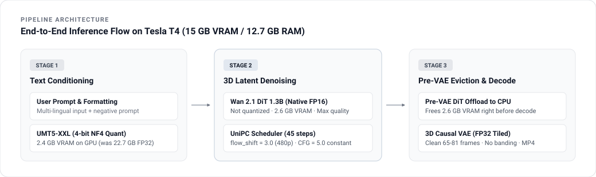
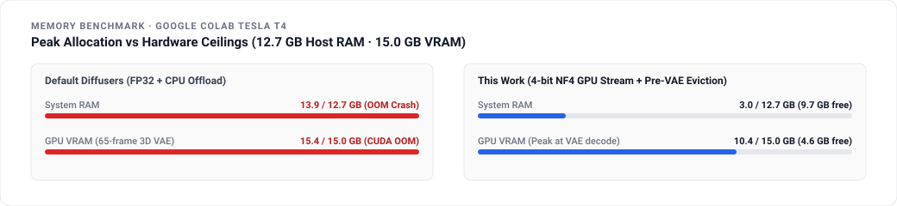

<div align="center">
  
  <br/><br/>
  <a href="https://colab.research.google.com/github/rivas-vega/wan2.1-t4-colab/blob/main/wan2_1_t4_colab_free_inference.ipynb">
    
  </a>
  <a href="https://huggingface.co/Wan-AI/Wan2.1-T2V-1.3B-Diffusers">
    
  </a>
  
  
</div>

<br/>

## Motivation

This project originated after working on the quantization and model compression lab in the **ALTEGRAD** (*Advanced Learning for Text and Graph Data*, M2 MVA) course. While applying 4-bit and 8-bit weight quantization to large language models (LLMs) is well established, running modern **generative video foundation models** on consumer hardware presents a more complex systems challenge.

Video diffusion pipelines do not just host a single model—they orchestrate:
1. A massive language model text encoder (**UMT5-XXL**, 22.7 GB in FP32).
2. A 3D spatiotemporal diffusion transformer (**DiT**, 1.3B parameters).
3. A continuous 3D causal video autoencoder (**3D VAE**).

The goal of this work was to test whether quantization and selective memory offloading could make a complete state-of-the-art video model run end-to-end on a free **Google Colab Tesla T4** (`12.7 GB Host RAM`, `15.0 GB VRAM`) without crashing or sacrificing video texture quality.

---

## Overview

Alibaba's **Wan 2.1 (1.3B)** is an open-weights text-to-video model capable of high-fidelity spatiotemporal motion. However, running the default Hugging Face `diffusers` implementation requires over 32 GB of system RAM and 24+ GB of GPU VRAM. On a free Google Colab instance, the default pipeline immediately crashes:
- **Host RAM OOM:** Loading the 22.7 GB text encoder crashes Colab's 12.7 GB system RAM.
- **CUDA OOM:** Retaining all model weights during 65-frame 3D VAE decoding exceeds the 15.0 GB VRAM limit.

This repository provides an inference engine and clean Gradio studio tailored for constrained cloud GPUs, generating uncompressed **4.1-second (65 frames)** and **5.1-second (81 frames)** continuous 480p videos directly on a free Tesla T4.

---

## System Architecture & Demo

<div align="center">
  
</div>

<br/>

<table>
  <tr>
    <td width="42%" align="center" valign="middle">
      
    </td>
    <td width="58%" valign="middle">
      <h4>Unedited Output on Tesla T4</h4>
      <p><b>Prompt:</b></p>
      <blockquote>
        <i>"A young content creator holding a small vlogging camera at arm's length, walking through a sunny historic European street, smiling naturally to the camera with soft daylight"</i>
      </blockquote>
      <p>
        <b>Generation Specs:</b><br/>
        • <b>Resolution:</b> 480 × 832 (9:16 vertical)<br/>
        • <b>Length:</b> 65 frames · 4.1 s @ 16 fps<br/>
        • <b>Solver:</b> UniPC Multistep (45 steps, <code>flow_shift = 3.0</code>, <code>CFG = 5.0</code>)<br/>
        • <b>Seed:</b> <code>342683004</code><br/>
        • <b>Hardware:</b> NVIDIA Tesla T4 (Google Colab Free Tier)
      </p>
    </td>
  </tr>
</table>

---

## Technical Strategy & Quantization Breakdown

### What is quantized and what is not?

| Component | Uncompressed Size | Precision in Pipeline | Quantized? | Device Residency | Peak Memory |
| :--- | :---: | :---: | :---: | :---: | :---: |
| **Text Encoder (`UMT5-XXL`)** | 22.7 GB | **4-bit NF4** (`bitsandbytes`) | **Yes** | GPU VRAM | **2.4 GB VRAM** (Host RAM at 3.0 GB) |
| **Diffusion DiT (`WanTransformer3DModel`)** | 2.6 GB | **Native FP16** | **No** | GPU VRAM (moved to CPU pre-VAE) | **2.6 GB VRAM** |
| **3D Causal VAE** | 1.2 GB | **FP32** (spatial & temporal tiling) | **No** | GPU VRAM | **~6.5 GB VRAM** during decode |

<br/>

### 1. Direct-to-GPU 4-bit NF4 Quantization for UMT5
- **The Issue:** `UMT5-XXL` weighs 22.7 GB in FP32 across 6 shards. Loading it onto CPU or using default `device_map="auto"` immediately exceeds Colab's 12.7 GB system RAM, causing the Linux kernel to kill the process.
- **The Solution:** We stream the shards directly into GPU memory (`device_map={"": 0}`) using 4-bit NormalFloat (`bnb_4bit_quant_type="nf4"`). This compresses the text encoder down to **2.4 GB VRAM** and keeps system RAM at only **3.0 / 12.7 GB**, leaving nearly 10 GB of host memory free.

### 2. Native FP16 for the Diffusion Transformer (Unquantized)
- The 1.3B parameter 3D DiT is kept in native `float16` precision (~2.6 GB VRAM).
- **Why not quantize the DiT?** Quantizing the diffusion transformer to 4-bit or 8-bit causes noticeable temporal flicker and degrades micro-textures (skin, hair, fabric, fine architectural details). Keeping it in FP16 retains full visual quality while running at peak throughput on the T4's Tensor Cores.

### 3. Tiled FP32 for the 3D Causal VAE (Unquantized)
- The 3D VAE runs in `float32` with `enable_tiling()` and `enable_slicing()`.
- Running the VAE in FP16 leads to severe color posterization and banding artifacts in Wan 2.1. Executing it in FP32 with spatial and temporal tiling keeps colors natural and gradients smooth without exceeding VRAM.

### 4. Pre-VAE Dynamic DiT Eviction
- **The Issue:** Decoding 65 frames of 3D latent volume requires significant temporary memory. If the 2.6 GB DiT remains in VRAM during VAE decoding, peak memory crosses 15.0 GB and triggers a CUDA OOM.
- **The Solution:** At the completion of the final denoising step (`step_index == total_steps - 1`), the pipeline temporarily offloads `pipe.transformer` to free system RAM (`transformer.to("cpu")`) and clears the CUDA cache. This opens **over 4.5 GB of additional VRAM headroom** exclusively for 3D video decoding.

### 5. 480p Noise Schedule Tuning (`flow_shift = 3.0`)
- Wan 2.1 defaults to `flow_shift = 5.0`, which is tuned for 720p generation. At 480p ($480 \times 832$), this shifts too many solver steps into the high-noise regime, leaving too few steps for the low-noise regime where textures settle.
- Configuring `UniPCMultistepScheduler` with **`flow_shift = 3.0`** over 45 steps and a constant `guidance_scale = 5.0` restores crisp micro-contrast and fine details.

### 6. Low-Level System Allocator Tuning
- `HF_HUB_DISABLE_XET=1`: Prevents duplicate in-memory buffering during Hugging Face shard downloads.
- `glibc malloc_trim(0)`: Calls the C-level memory allocator to force immediate release of unreferenced pages back to the operating system.

---

## Memory Benchmark

<div align="center">
  
</div>

<br/>

| Pipeline | Host RAM (12.7 GB limit) | GPU VRAM (15.0 GB limit) | Operational Status |
| :--- | :---: | :---: | :---: |
| **Default Diffusers** | `13.9 GB` | `> 15.0 GB` | **Crash (OOM)** during UMT5 load or VAE decode |
| **This Pipeline** | **`3.0 GB`** *(9.7 GB free)* | **`10.4 GB`** *(4.6 GB free)* | **Stable generation** (65–81 frames) |

---

## Generation Presets

| Preset | Resolution | Duration | Frames | Solver Configuration | Peak VRAM |
| :--- | :---: | :---: | :---: | :---: | :---: |
| **`Reel 9:16 · 4s`** *(Default)* | `480 × 832` | **4.1 s** (16 fps) | `65` | UniPC (flow_shift=3.0, 45 steps, CFG=5.0) | `10.4 GB` |
| **`Reel 9:16 · 5s`** | `480 × 832` | **5.1 s** (16 fps) | `81` | UniPC (flow_shift=3.0, 45 steps, CFG=5.0) | `11.2 GB` |
| **`Cinema 16:9 · 4s`** | `832 × 480` | **4.1 s** (16 fps) | `65` | UniPC (flow_shift=3.0, 45 steps, CFG=5.0) | `10.4 GB` |

---

## Quick Start (Google Colab)

1. Open [`wan2_1_t4_colab_free_inference.ipynb`](https://colab.research.google.com/github/rivas-vega/wan2.1-t4-colab/blob/main/wan2_1_t4_colab_free_inference.ipynb) in Google Colab.
2. Ensure hardware accelerator is set to **Runtime → Change runtime type → T4 GPU**.
3. Run the notebook cells sequentially:
   - **Step 1:** Installs required packages and sets environment variables.
   - **Step 2:** *(Optional)* Input a Hugging Face read token to speed up weight downloads.
   - **Step 3 / 4:** Preloads the pipeline or launches the clean Gradio web studio directly.

---

## Repository Structure

```text
├── assets/
│   ├── hero_banner.svg             # Header banner graphic
│   ├── pipeline_architecture.svg   # End-to-end inference pipeline diagram
│   ├── memory_telemetry.svg        # Memory benchmark diagram
│   ├── demo_t4_vlog.gif            # 65-frame sample with rounded corners
│   └── demo_t4_vlog.mp4            # Full-quality H.264 video source
├── wan2_1_t4_colab_free_inference.ipynb  # One-click Google Colab notebook
├── app.py                          # Minimalist Gradio studio interface
├── pipeline_utils.py               # 4-bit NF4 GPU loader, pre-VAE eviction & scheduler
├── requirements.txt                # Python package dependencies
└── README.md                       # Technical documentation
```

---

## Author

**Pedro** ([@rivas-vega](https://github.com/rivas-vega))  
M2 MVA, École Normale Supérieure Paris-Saclay · B.S. in Mathematics, Universidad de Sevilla
